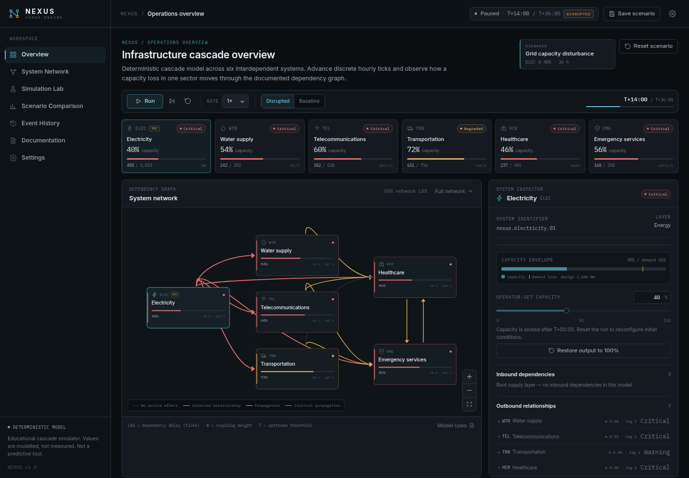
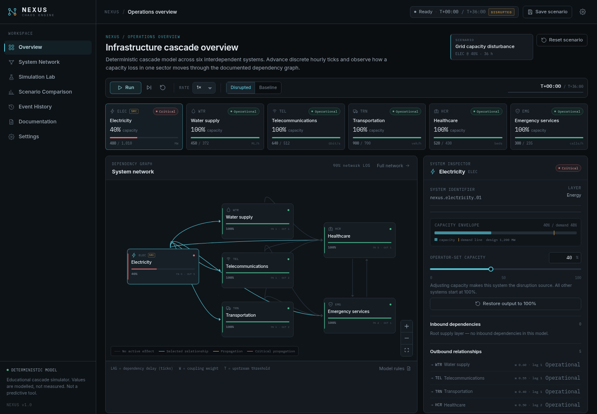
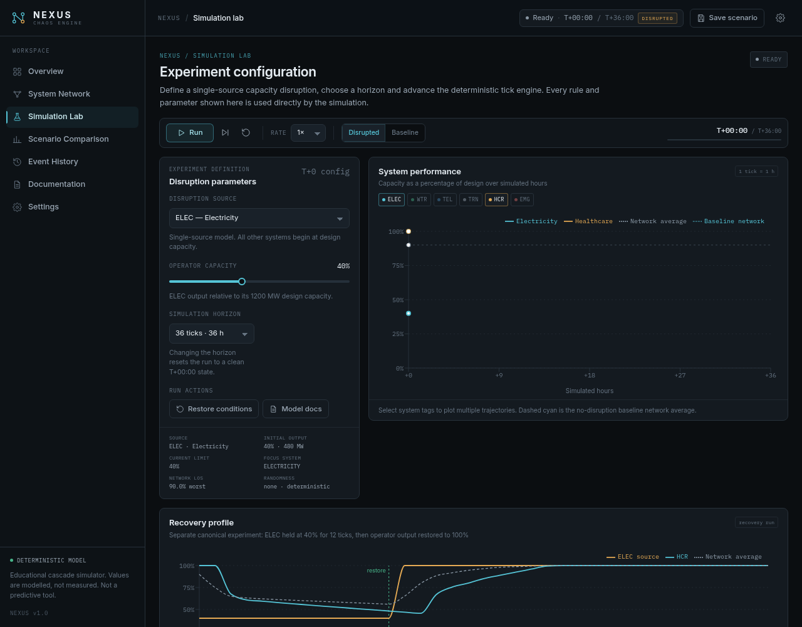
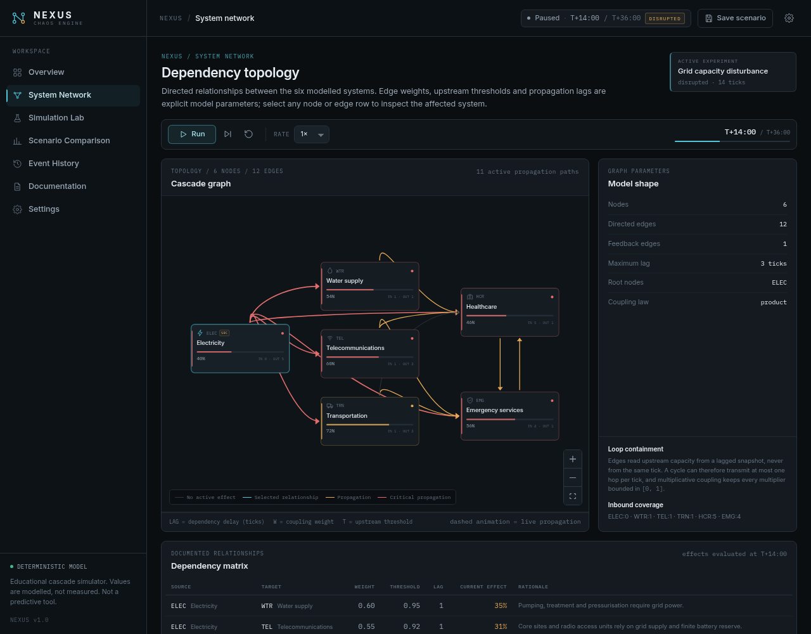
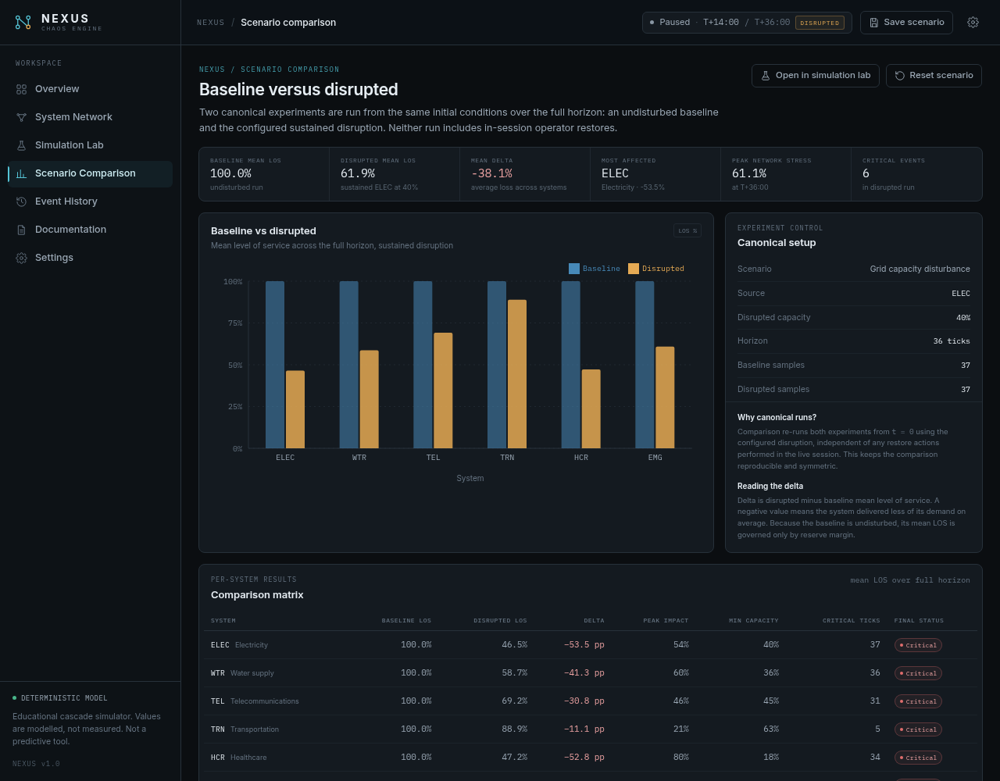
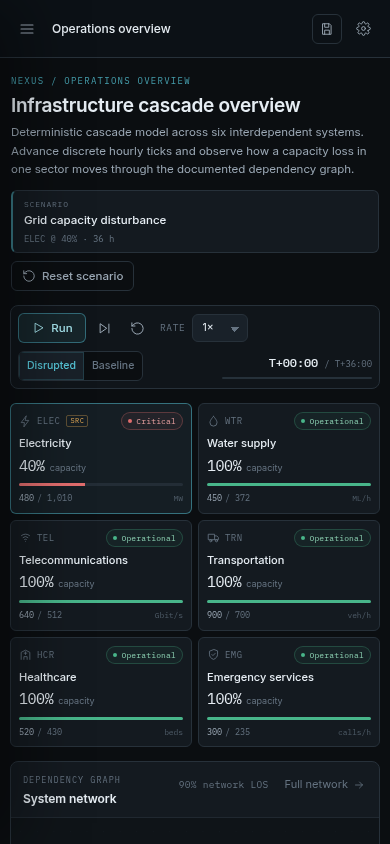
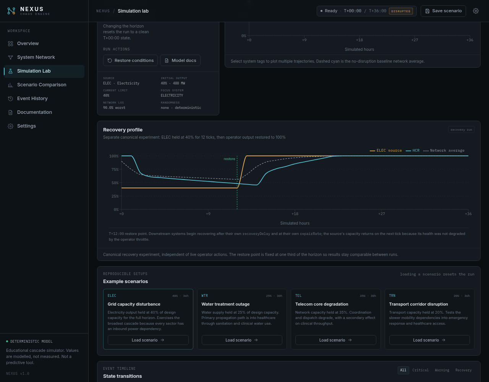

# NEXUS: CHAOS ENGINE

**A deterministic, discrete-time infrastructure cascade simulator.**

NEXUS models six interdependent infrastructure systems — electricity, water, healthcare, transportation, telecommunications and emergency services — as a directed dependency graph. An operator can reduce one system's capacity, advance the simulation one simulated hour at a time, and observe how the resulting deficit propagates through documented coupling weights, thresholds and lags.



> **Engineering integrity notice:** NEXUS is an educational systems-modelling exercise. Its capacities, demands, weights and recovery rates are illustrative assumptions. It does **not** predict real infrastructure failures, and no output should be used for operational planning, emergency response or public-safety decisions.

---

## What works

- **Six modelled systems** with status, capacity, demand, dependency relationships and recovery parameters.
- **Directed dependency graph** built with React Flow, with custom technical nodes and propagation-aware edges.
- **Deterministic simulation engine** using explicit, documented equations. Same configuration and actions produce byte-identical results.
- **Interactive controls:** run, pause, single-step, reset, restorable operator capacity, playback rate, baseline/disrupted view.
- **Inspector panel** that exposes live state, dependency multipliers, inbound/outbound edges and recovery kinetics.
- **Analytics:** capacity time series, peak-impact analysis, event timeline, canonical recovery profile and baseline-versus-disrupted comparison.
- **Reproducible example scenarios** and local scenario storage in the browser.
- **No backend, paid API, AI service or random damage model.**

---

## Quick start

Requirements: Node.js 18+ and npm.

```bash
npm install
npm run dev
```

Open the URL printed by Vite (default `http://localhost:5173`).

```bash
npm test        # 21 simulation and analytics tests
npm run build   # production bundle
npm run preview # serve the production build
```

---

## Use the simulator

1. Open **Overview** or **Simulation Lab**.
2. Select any system in the network graph, inspector or status strip.
3. Set its **operator capacity** below 100%. That system becomes the disruption source.
4. Press **Run**, or use the step button to advance one discrete tick (one simulated hour).
5. Watch dependent systems lose effective capacity at their documented lag. Edges turn amber/red when propagating.
6. Select **Baseline** to view the undisturbed network at the same tick, or open **Scenario Comparison** for a full-horizon baseline comparison.
7. Use **Restore output to 100%** to allow gradual recovery, or **Reset scenario** to return to configured initial conditions.
8. **Save scenario** stores the experiment configuration in local browser storage. Load or delete saved scenarios in **Settings**.

Mid-run capacity changes are intentionally restricted to restoring the existing source. Reset the run to reconfigure the experiment. This keeps each live run attributable to one disclosed intervention.

### Example scenarios

| Scenario | Source | Initial output | Horizon | Primary path |
| --- | --- | --- | --- | --- |
| Grid capacity disturbance | ELEC | 40% | 36 h | Power → water, telecom, transport, healthcare, emergency |
| Water treatment outage | WTR | 25% | 30 h | Water → healthcare; secondary emergency effects |
| Telecom core degradation | TEL | 35% | 30 h | Telecom → emergency and healthcare coordination |
| Transport corridor disruption | TRN | 20% | 36 h | Transport → emergency response and clinical access |

Each is available in **Simulation Lab → Example scenarios**.

---

## Model at a glance

A full derivation, parameter tables and assumptions are in [`docs/MODEL.md`](docs/MODEL.md).

For every system `s` at tick `t`, with health `h`, operator limit `o` and dependency multiplier `D`:

```text
e_s(t) = h_s(t) · o_s(t) · D_s(t)
LOS_s(t) = min(e_s(t) · designCapacity_s / demand_s(t), 1)
```

For each incoming dependency edge `i → s` with weight `w`, threshold `θ` and lag `L`:

```text
deficit_i(t)   = clamp((θ_i − e_i(t − L)) / θ_i, 0, 1)
transmitted_i(t) = w_i · deficit_i(t)
D_s(t)         = Π_i (1 − transmitted_i(t))
```

Health degrades only from dependency-induced shortfall and recovers after a per-system delay at a per-system repair rate. Multiplicative coupling keeps `D` bounded in `(0, 1]`; lagged reads ensure cycles transmit at most one hop per tick. There is no random source anywhere in the engine.

---

## Project structure

```text
.
├── docs/
│   ├── MODEL.md              # equations, parameters, assumptions, limitations
│   ├── ARCHITECTURE.md       # stack, data flow, module boundaries
│   └── screenshots/          # real captures of the running app
├── src/
│   ├── components/           # graph, inspector, charts, timeline, shell
│   ├── data/                 # systems, dependency graph, scenarios, navigation
│   ├── simulation/           # deterministic engine, analytics, formatting
│   ├── state/                # simulation context and local storage
│   ├── tests/                # Vitest engine and analytics tests
│   ├── views/                # overview, network, lab, comparison, docs, settings
│   ├── App.jsx
│   ├── main.jsx
│   ├── styles.css
│   └── flow.css
├── CONTRIBUTING.md
├── LICENSE
└── README.md
```

Technology: React 18, Vite 5, React Flow 11, Recharts 2, plain CSS, Vitest. No backend.

---

## Screenshots

| Operations overview | Simulation lab |
| --- | --- |
|  |  |

| Cascading propagation after 14 ticks | Dependency topology |
| --- | --- |
|  |  |

| Scenario comparison | Mobile layout |
| --- | --- |
|  |  |

| Recovery profile (canonical restore experiment) |
| --- |
|  |

All screenshots are captured from the application itself; no mockups are used.

---

## Verification

```bash
npm test
```

The test suite covers:

- initial conditions and seeded disruption state;
- the edge transmission equation and threshold law;
- lag timing for first- and second-order dependents;
- bounded state with the healthcare ↔ emergency feedback cycle;
- determinism across repeated full runs;
- operator restoration and delayed recovery;
- status band boundaries;
- graph integrity and example scenario reproducibility;
- canonical recovery experiment timing and reproducibility;
- analytics, comparison matrix and chart series construction.

---

## Engineering integrity and limitations

This is a **model, not a measurement system**.

- Values are normalized aggregates with indicative units, chosen for a readable educational demonstration.
- Dependency weights, thresholds, lags, degradation rates and repair rates are assumptions. They have not been calibrated against historical outage data.
- Six systems are aggregated; there is no geography, asset-level topology, time-of-day demand profile, redundancy modelling, economics or human behaviour.
- The simulator supports a single-source sustained disruption. Multiple simultaneous or staged incidents are outside the current scope.
- Comparison runs are canonical: both baseline and disrupted runs restart at `t = 0` and apply the configured disruption for the full horizon, independent of in-session restores.
- The recovery profile uses a fixed analytical restore point and model kinetics; it is not a repair schedule or a restoration forecast.
- Outputs must not be interpreted as forecasts, risk assessments or operational guidance.

See [`docs/MODEL.md`](docs/MODEL.md) for the complete limitations section.

---

## Roadmap

- Multi-source and staged disruptions with a scenario timeline.
- Parameter sensitivity sweeps and tornado charts.
- Reproducible Monte Carlo ensembles with explicit seeds.
- Scenario import/export and report generation.
- Redundancy and islanding states for power and water networks.
- Calibration exercises against published resilience case studies.
- Optional asset-level subgraphs while retaining the aggregate model.

---

## License and contributing

Released under the [MIT License](LICENSE). Contributions are welcome; read [CONTRIBUTING.md](CONTRIBUTING.md) before opening a pull request. Model changes must include updated equations, documentation and tests.
